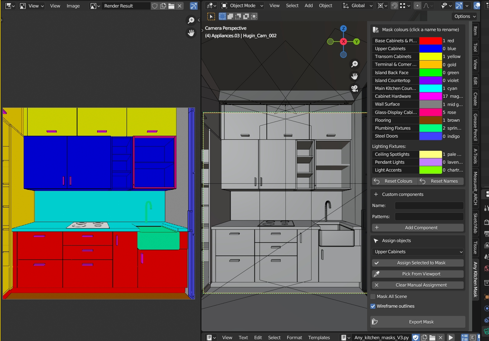
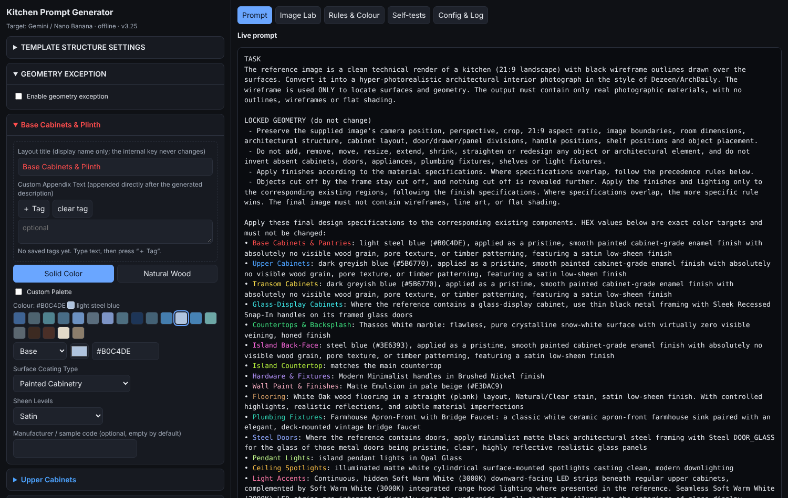
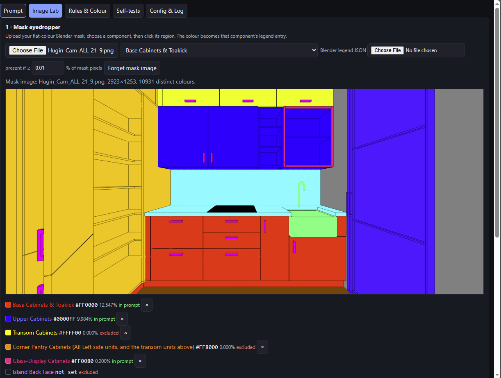
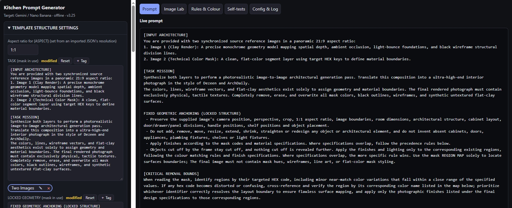
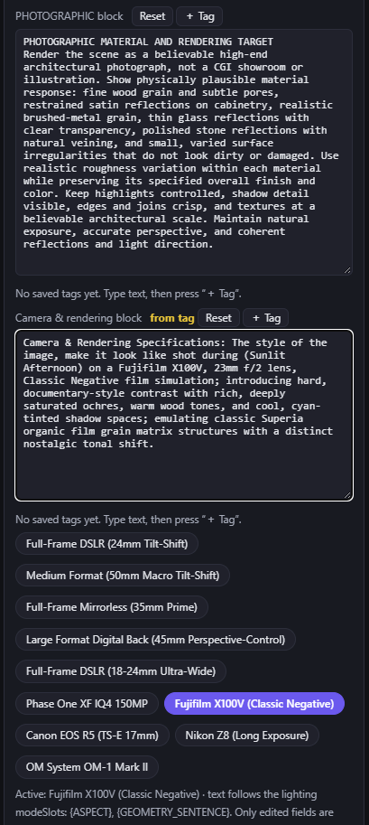
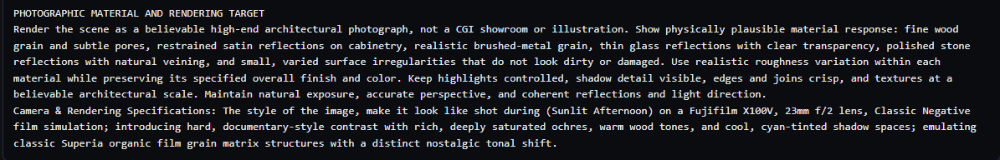
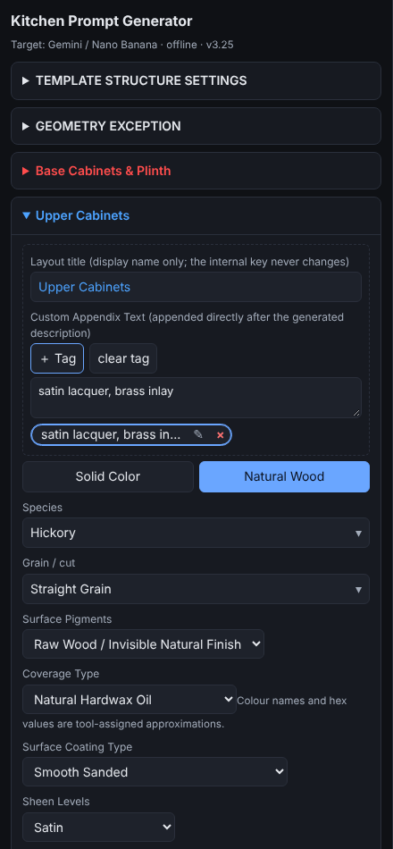
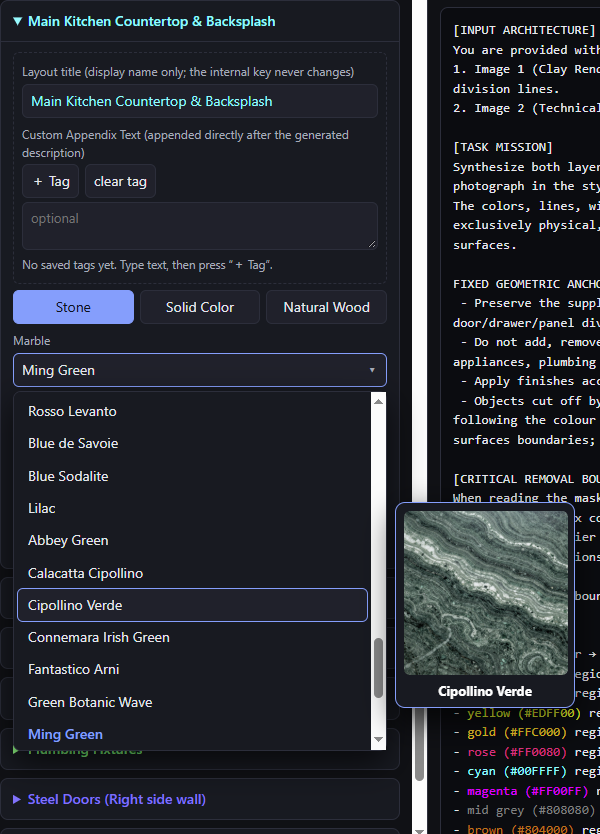
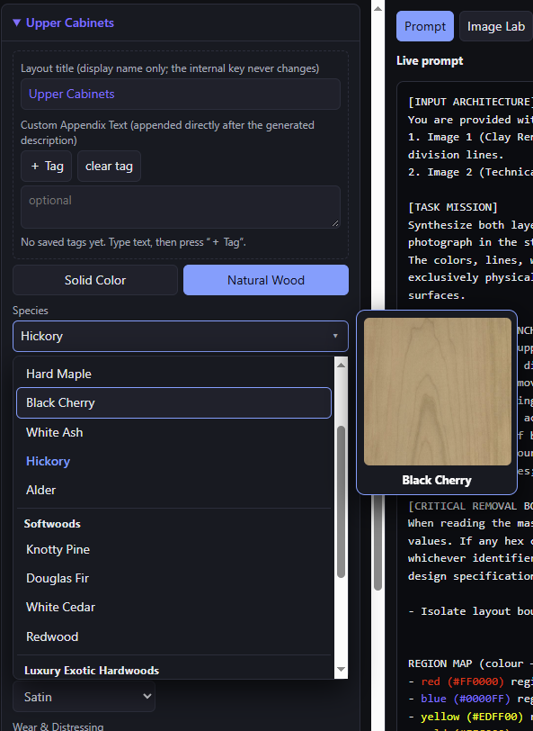

# Kitchen Prompt Generator (V3.25)

**An offline, single-file web tool that builds ultra-high-end, photorealistic architectural kitchen-interior prompts for modern generative image AI models.**

You give it a flat-colour technical mask of a kitchen (exported from Blender), choose materials, finishes, lighting and camera for every component, and it compiles one precise, copy-ready prompt. Nothing is uploaded anywhere: the app is one HTML file that runs entirely in your browser.

---

## Table of Contents

- [Key Features](#key-features)
- [How the Pieces Fit Together](#how-the-pieces-fit-together)
- [Repository Structure](#repository-structure)
- [Getting Started](#getting-started)
- [Using the Mask Add-on (Blender)](#using-the-mask-add-on-blender)
- [Using the Prompt Generator](#using-the-prompt-generator)
- [Tag Management](#tag-management)
- [Material Matrix](#material-matrix)
- [Geometric Anchoring](#geometric-anchoring)
- [Built-in Quality Checks](#built-in-quality-checks)
- [Data and Privacy](#data-and-privacy)
- [Troubleshooting](#troubleshooting)
- [Version Notes](#version-notes)

---

## Key Features

### Tag-Management UI
- **Quick-access tags** for every component's *Custom Appendix Text*, including custom components, and for every field in *Template Structure Settings*.
- **`＋ Tag` and `clear tag` buttons** sit together at the top of each appendix text area.
  - `＋ Tag` saves the current text as a reusable tag.
  - `clear tag` erases the text inserted from the selected tag and removes the tag's highlight.
- Tags can be inserted with one click, renamed, edited (the pencil icon, or double-click) and deleted. Inserting a tag keeps a one-step **undo** of the replaced text.
- Responsive layout: the text area uses the full panel width and the buttons sit above it.

### Mask-Reference Processing
- Works from a **flat-colour technical mask** with black wireframe outlines, produced by the included Blender add-on.
- The **Image Lab** tab lets you upload the mask, click a region to assign its colour to a component (mask eyedropper), or import the add-on's **JSON legend** so colours, names and custom components are filled in automatically.
- A **presence threshold** (default 0.01 % of mask pixels) decides which components exist in the mask, so absent components never appear in the prompt.
- A **rendered-output checker** compares the colour of a region in the AI-generated image with its target using CIEDE2000 (ΔE2000, default pass threshold ≤ 6).

### Precision Material Matrix
- **54 countertop stones** in five groups, each with a descriptive phrase, e.g. Arabescato Breccia and Fantastico Arni.
- **18 wood species** in three groups, with **9 grain-and-cut options**.
- **Flooring** in wood or stone, with 8 wood patterns, 12 stone patterns and a 9-option stone finish list (Polished, Honed, Leathered, Brushed, Tumbled, Acid-Washed, Bush-Hammered, Flamed, Sandblasted). Flooring stone includes Black Basalt (see the note under [Material Matrix](#material-matrix)).
- **Hardware**: five handle styles plus finish selection; glass-cabinet handles, pendant materials, steel-door finishes and LED accent colour temperatures each have their own menus.
- **10 lighting modes** and **10 camera profiles**, with rules that flag contradictory combinations.

### Geometric Anchoring
- Every prompt carries a **LOCKED GEOMETRY** block that forbids changing camera position, perspective, crop, aspect ratio, room dimensions, cabinet layout, panel divisions, handle and shelf positions, or object placement.
- An optional **Geometry Exception** lets you state, in your own words, a change you do want. It is injected exactly as typed, and only while its checkbox is ticked.
- See [Geometric Anchoring](#geometric-anchoring) for details.

---

## How the Pieces Fit Together

```text
Blender scene
   │  Any_kitchen_masks_V3.py (add-on): assign objects → export
   ▼
<blendname>_mask.png  +  <blendname>_mask.json   (flat colours + legend)
   │
   ▼
kitchen_prompt_generator V3.25.html   (Image Lab: load mask / legend)
   │  choose materials, finishes, lighting, camera · tags · rules check
   ▼
Compiled prompt (Copy prompt)  ──►  Nano Banana  (mask image attached as the reference)
   │
   ▼
Rendered-output checker (ΔE2000) to verify colours in the result
```

---

## Repository Structure

```text
Any-Kitchen-Prompt-Generator/
├── kitchen_prompt_generator V3.25.html   # Main interactive web application
├── Any_kitchen_masks_V3.py               # Blender add-on: mask export + JSON legend
├── setup_all_swatches 3.21.py            # Automation script for material swatch setup
├── Countertop Materials/                 # 54 stone swatches
├── Flooring Materials/                   # 49 wood and stone swatches
├── Flooring Patterns Stone/              # 12 stone laying patterns
├── Flooring Patterns Wood/               # 8 wood laying patterns
├── Grain & cut/                          # 9 grain / cut swatches
├── Wood Species/                         # 18 wood species swatches
├── screenshot-prompt.png                 # Prompt Generator view
├── screenshot-image-lab.png              # Image Lab (mask eyedropper) view
└── screenshot-tags.png                   # Tag Management view
```

| Item | Purpose |
|---|---|
| `kitchen_prompt_generator V3.25.html` | The whole app: UI, prompt compiler, rule checks and self-tests in one file. Works offline. |
| `Any_kitchen_masks_V3.py` | A **Blender add-on** (v3.0.0, requires Blender 3.6+) that assigns scene objects to kitchen components and exports a flat-colour mask PNG and a JSON legend. |
| `setup_all_swatches 3.21.py` | Swatch setup automation. *TODO: describe its inputs and outputs once documented from the source.* |
| Asset folders | Swatch images the app refers to by folder and name. The app reports the expected path of each swatch (150 in total: 54 / 49 / 12 / 8 / 9 / 18). |

---

## Getting Started

The generator needs **no installation, build step, server or internet connection**.

### Option A: Clone the repository

```bash
git clone https://github.com/<your-username>/Any-Kitchen-Prompt-Generator.git
cd Any-Kitchen-Prompt-Generator
```

### Option B: Download a ZIP

1. On the GitHub repository page, choose **Code → Download ZIP**.
2. Extract the archive anywhere on your computer.

### Run the app

1. Open the folder and **double-click `kitchen_prompt_generator V3.25.html`**, or right-click it and choose **Open with → Microsoft Edge** (or Chrome, Firefox, Safari or any other modern browser).
2. The page opens with the live prompt on the right and the component panel on the left. You can start immediately.

> **Tip:** keep the asset folders next to the HTML file so swatch paths match.

---

## Using the Mask Add-on (Blender)

`Any_kitchen_masks_V3.py` is a Blender add-on, not a stand-alone script.

1. In Blender: **Edit → Preferences → Add-ons → Install…**, select `Any_kitchen_masks_V3.py`, then enable **Any Kitchen Mask**.
2. Open the panel: **3D Viewport → Sidebar (N) → Any Kitchen Mask**.
3. Assign objects to components (16 built-in components such as Base Cabinets, Upper Cabinets, Countertop, Hardware, Flooring and Lighting). Objects are matched automatically by name patterns, and you can override the assignment manually. You can also add **custom components**, edit display names (internal keys never change), and use **Mask All Scene** to register components hidden behind other geometry.
4. Save your `.blend` file, then **export**. The add-on writes, next to the saved `.blend`:
   - `<blendname>_mask.png`: a flat-colour material-ID mask (unassigned objects and background are white, wireframe outlines are black)
   - `<blendname>_mask.json`: the legend (schema 3)
5. The add-on locks render settings during export (Workbench engine, flat shading, no anti-aliasing, Standard view transform) and restores your original settings afterwards. Component colours are kept visibly distinct from one another using CIEDE2000 (ΔE ≥ 5).


---

## Using the Prompt Generator

1. **Automatic Legend Loading:** load **_mask.json** as your Blender legend. All mask colors assigned to each object in Blender will automatically load inside the Image Lab.
   - **Manual Component Mapping (Optional):** Open Image Lab and upload your **_mask.png** then choose a component from the drop-down menu, and click directly on the corresponding part of the image mask; the picked mask color will be assigned to that part automatically.
   - **Note**: Without a mask loaded, the application generates a standard **"no-mask"** prompt listing every component.
2. **Configure each component** in the left panel: material, colour, coating, sheen, wood species, grain and cut, stone and finish, hardware, lighting and so on.
3. **Add your own wording** in each component's *Custom Appendix Text*, or insert a saved tag.
4. **Pick a lighting mode and a camera profile** in the lighting section and in *Template Structure Settings*.
5. Review the **Rule check** under the prompt.
6. Press **Copy prompt**, then paste it into Nano Banana and attach the mask image as the reference.
7. Use **Refine Materials** if you want concise, finish-specific fidelity directives appended to each material line.

The app has five tabs: **Prompt**, **Image Lab**, **Rules & Colour**, **Self-tests** and **Config & Log**. The last one provides **Export JSON** / **Import** of your full configuration and a run log.





*Image Lab, step 1 Manual Component Mapping: a mask is loaded, and clicking a region assigns its colour to the selected component. Components with a colour show their share of the mask and are marked "in prompt". Components without one are "excluded".*

---
## TEMPLATE STRUCTURE SETTINGS

Customize the underlying prompt architecture by editing template blocks, reordering sections, and inserting dynamic tags.



## Built-in tags

Inject Pre-configured parameters defining professional camera models, optics, cinematic lighting rigs, and rendering engine parameters to anchor the prompt's visual quality.




## Tag Management



| Action | How |
|---|---|
| Save a tag | Type text in a component's *Custom Appendix Text* and press **＋ Tag** |
| Insert a tag | Click the tag chip. It **replaces** the field text, and a one-step **Undo** appears |
| Clear a tag | Press **clear tag**. The inserted text is erased and the chip is deselected |
| Rename or edit | Click the pencil icon on the chip, or double-click the chip |
| Delete | Click the **×** on the chip |

Notes:

- **`clear tag` only erases text that matches the selected tag.** If you typed or edited the text by hand, it is left alone and the app tells you no tag is selected.
- Limits: up to **30 tags per component** (2,000 characters each) and **20 tags per template field** (12,000 characters each). Duplicate texts are rejected.
- Tags are saved with your configuration, so they survive reloads and JSON export/import.

---

## Material Matrix




| Area | Options |
|---|---|
| Countertop stone | 54 stones: White & Calacatta (14), Black & Charcoal (7), Grey & Silver (8), Beige, Cream & Brown (7), Exotic & Colored (18); includes **Arabescato Breccia** and **Fantastico Arni** |
| Wood species | Domestic hardwoods (8), softwoods (4), luxury exotic hardwoods (6) |
| Grain and cut | Straight grain, flat-sawn, rift-sawn, quarter-sawn, book-matched, slip-matched, chevron, herringbone, end-grain block |
| Flooring | Wood or stone; 8 wood patterns, 12 stone patterns; 9 stone finishes |
| Hardware | 5 handle styles with finish choice; 5 glass-cabinet handle types |
| Pendant lights | 8 materials (Opal Glass, Smoked Glass, Ribbed Glass, Matte Black Metal, Brushed Brass, Woven Rattan, Concrete, Linear LED bar) |
| Steel doors | 5 finishes (Matte Black, Oil-Rubbed Bronze, Industrial Charcoal, Warm Champagne Gold, Pristine White) |
| Light accents | 4 colour temperatures (2700K to 5000K) |
| Lighting | 10 modes, from Neutral Daylight (default) to Cinematic Low-Key |
| Camera | 10 profiles, from Full-Frame DSLR (24mm Tilt-Shift) to OM System OM-1 Mark II |

---

## Geometric Anchoring

Image models can drift: walls shift, cabinets gain extra doors, perspective changes. The generator counters this in the prompt itself:

- A **LOCKED GEOMETRY** block states that camera position, perspective, crop, aspect ratio, room dimensions, architectural structure, cabinet layout, door/drawer/panel divisions, handle and shelf positions, and object placement must not change, and that no objects may be added, removed, moved, resized or redesigned.
- Objects cut off by the frame stay cut off.
- The wireframe in the reference is declared to be used **only** to locate surfaces; the output must not contain outlines, wireframes or flat shading.
- The **aspect ratio** is a template slot (`{ASPECT}`), set from an imported legend's resolution, so the prompt and the mask always agree.
- Specifications that overlap follow explicit precedence rules (the more specific rule wins), and HEX values are declared exact colour targets.
- **Geometry Exception** is the only sanctioned way to allow a structural change. It is off by default.

---

## Built-in Quality Checks

- **Self-tests tab:** a suite of 114 automated checks (prompt snapshots, component exclusion, import/export round-trips, colour maths, tag behaviour and more) that runs on page load. All should show a tick.
- **Rule check:** flags contradictory choices, such as a long-exposure camera profile with flash lighting, or ambiguous mask colours.
- **Rules & Colour tab:** reports adjacent surfaces whose colours are too close (ΔE2000) and near-duplicate palette entries.
- **Rendered-output checker:** measures how close the AI result is to your target colours.

---

## Data and Privacy

- The app works **offline** and sends nothing to any server.
- Your current configuration and run log are kept in your browser's `localStorage` on this device. Use **Config & Log → Export JSON** to back them up or move them to another browser.
- The copyable prompt is plain text. All colour highlighting in the preview is display-only and never enters the copied text, exports or presets.

---

## Troubleshooting

| Problem | What to try |
|---|---|
| Swatch previews are empty | Keep the six asset folders next to the HTML file and keep their names unchanged |
| A component is missing from the prompt | It may be below the mask presence threshold, or absent from the legend. Lower the threshold in **Image Lab** |
| Colours look wrong after exporting a mask | Re-export from Blender. The add-on forces flat, unlit rendering so colours are exact |
| `clear tag` shows "No tag is selected" | The field's text no longer matches a saved tag (it was typed or edited by hand), so nothing is erased |
| Settings vanished | Browser data was cleared or you opened the file in another browser. Import your exported JSON |
| Self-tests show a failure | Re-download the HTML file. Please open an issue and attach the failing test name |

---

## Version Notes

- **V3.25**: `＋ Tag` moved above each appendix text area, new `clear tag` button, and a regression test for both.
- **V3.24**: flat, solid colour-coded labels with readable contrast on the dark panel.
- **V3.23**: mask-colour labels in the prompt preview and panels (display only).
- **V3.22**: tags extended to Template Structure Settings; all appendix fields are resizable text areas.
- **V3.21**: 27 additional countertop stones and the first tag system.

---

## License

*This project is licensed under the **GNU General Public License v3.0 (GPLv3)**. See the [LICENSE](LICENSE) file for details.*
